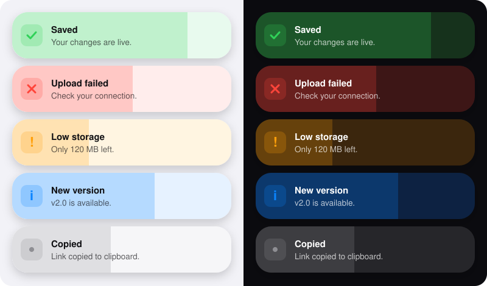

<h1 align="center">react-native-toast-kit</h1>

<p align="center">
  Glass-style toast notifications for React Native CLI.<br />
  Pure JS · no native modules · no pods · no linking · zero dependencies.
</p>

<p align="center">
  
</p>

<p align="center">
  
</p>

<p align="center">
  <a href="https://www.npmjs.com/package/react-native-toast-kit"></a>
  
  
  <a href="LICENSE"></a>
</p>

## ✨ Features

- 🪟 **Glass look**: translucent body, specular highlight, tinted icon badge
- ⏳ **Progress bar**: the background fill drains over the duration, then the toast hides itself
- 🎨 **Five types**: success, error, warning, info, default, each with its own color
- 🌗 **Light and dark mode**: follows the system color scheme
- 👆 **Swipe to dismiss**: dragging pauses the timer; releasing resumes it
- 📍 **Top or bottom**: position each toast individually
- 🧩 **Call from anywhere**: inside components, services or plain functions
- 🔷 **TypeScript**: fully typed API

## 📦 Install

```sh
npm install react-native-toast-kit
# or
yarn add react-native-toast-kit
```

No pods, no linking, no extra dependencies.

## 🚀 Quick start

Wrap your app once:

```tsx
import { ToastProvider } from 'react-native-toast-kit';

export default function Root() {
  return (
    <ToastProvider>
      <App />
    </ToastProvider>
  );
}
```

Then call it from anywhere:

```tsx
import { Toast } from 'react-native-toast-kit';

Toast.success('Saved', 'Your changes are live.');
Toast.error('Upload failed', 'Check your connection.');
Toast.warning('Low storage');
Toast.info('New version available');
Toast.message('Copied', undefined, { position: 'bottom' });
```

## 🎛 Examples

```tsx
// Stay longer, hide the progress fill
Toast.info('Syncing…', 'This can take a moment.', {
  duration: 8000,
  showProgress: false,
});

// Stay until dismissed (no progress, no auto-hide)
const id = Toast.show({ type: 'warning', title: 'Offline', duration: 0 });
Toast.hide(id);

// Tap action + lifecycle callback
Toast.success('Message sent', 'Tap to open the chat.', {
  onPress: () => openChat(),
  onHide: () => console.log('gone'),
});

// Remove every visible toast
Toast.hide();
```

## 📚 API

### Shorthands

`Toast.success`, `Toast.error`, `Toast.warning`, `Toast.info` and `Toast.message` all share this signature and return the toast id:

```ts
Toast.success(title: string, message?: string, options?: ToastOptions): string
```

### `Toast.show(options)`

Accepts every option below and returns the toast id.

### `Toast.hide(id?)`

Removes one toast, or all of them when no id is given.

### Options

| Option           | Type                                                       | Default   | Description                                          |
| ---------------- | ---------------------------------------------------------- | --------- | ---------------------------------------------------- |
| `type`           | `'success' \| 'error' \| 'warning' \| 'info' \| 'default'` | `default` | Color and icon                                       |
| `title`          | `string`                                                   |           | Bold first line                                      |
| `message`        | `string`                                                   |           | Secondary text (up to 3 lines)                       |
| `duration`       | `number` (ms, `0` = until dismissed)                       | `5000`    | How long the toast stays; also the progress length   |
| `showProgress`   | `boolean`                                                  | `true`    | Draining progress fill in the background             |
| `position`       | `'top' \| 'bottom'`                                        | `top`     | Where the toast appears                              |
| `offset`         | `number`                                                   | `0`       | Extra distance from the screen edge                  |
| `swipeToDismiss` | `boolean`                                                  | `true`    | Swipe toward the edge to dismiss                     |
| `onPress`        | `() => void`                                               |           | Called on tap, then the toast dismisses              |
| `onHide`         | `() => void`                                               |           | Called after the toast is removed                    |

## 🎨 Types

| Type      | Accent    | Use for                     |
| --------- | --------- | --------------------------- |
| `success` | `#30D158` | Completed actions           |
| `error`   | `#FF453A` | Failures                    |
| `warning` | `#FF9F0A` | Things that need attention  |
| `info`    | `#0A84FF` | Neutral updates             |
| `default` | `#8E8E93` | Everything else             |

## 🧪 Try the example app

```sh
yarn
yarn example start
yarn example ios      # or: yarn example android
```

## 🤝 Contributing

See [CONTRIBUTING.md](CONTRIBUTING.md) and the [code of conduct](CODE_OF_CONDUCT.md).

## 📄 License

MIT
